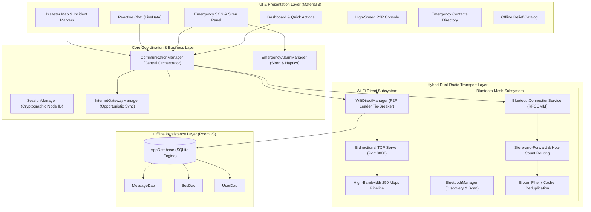

# 🌐 ResilientNet
### *Offline-First Disaster Coordination & Hybrid Mesh Communication Network*

[](https://developer.android.com)
[](https://www.oracle.com/java/)
[-4285F4?style=for-the-badge&logo=sqlite&logoColor=white)](https://developer.android.com/training/data-storage/room)
[](https://developer.android.com/guide/topics/connectivity/bluetooth)
[-FF7043?style=for-the-badge&logo=wi-fi&logoColor=white)](https://developer.android.com/guide/topics/connectivity/wifip2p)
[](https://m3.material.io)

---

## 📌 Executive Summary

During catastrophic natural disasters (earthquakes, cyclones, floods, tsunamis), conventional cellular infrastructure (cell towers, fiber backhauls, power grids, and internet service providers) routinely suffers catastrophic failure. First responders and affected populations face immediate communication blackouts, stranding victims and critically delaying life-saving rescue operations.

**ResilientNet** is an offline-first, decentralized disaster coordination platform designed for civilian smartphones. It bridges smartphones into an autonomous, self-healing peer-to-peer network without requiring cell towers, Wi-Fi routers, satellite dishes, or internet connectivity. Utilizing a novel **hybrid dual-radio architecture**, ResilientNet dynamically balances battery-efficient background **Bluetooth Multi-Hop Mesh** routing with high-bandwidth, long-range **Wi-Fi Direct P2P tunnels**.

---

## 🏗️ System Architecture



---

## ⚡ Dual-Radio Hybrid Networking Comparison

ResilientNet eliminates single-point-of-failure networking by fusing two complementary wireless protocols:

| Feature / Metric | 🔵 Bluetooth Mesh (RFCOMM) | 🟠 Wi-Fi Direct P2P Tunnel |
| :--- | :--- | :--- |
| **Primary Use-Case** | Continuous background beaconing, text mesh | High-speed batch transfer, chat, instant SOS |
| **Data Throughput** | ~1 - 2 Mbps (Low bandwidth) | **Up to 250 Mbps (~100x Bluetooth speed)** |
| **Operational Range** | 10 - 30 meters per hop | **100 - 200 meters** (Line-of-Sight) |
| **Topology** | Decentralized Multi-hop (up to 7 hops) | Point-to-Point / Star Soft-AP Group |
| **Power Profile** | Minimal battery drain (All-day monitoring) | On-demand high-power burst transmission |
| **Hardware Requirement**| Bluetooth 4.2+ Classic RFCOMM | Wi-Fi 802.11 a/b/g/n/ac P2P (Wi-Fi Direct) |
| **Infrastructure** | **Zero** (No routers, no cell towers) | **Zero** (No routers, no internet access) |

---

## 🚀 Key Modules & Capabilities

### 1. 🚨 One-Tap Emergency SOS & Critical Siren
* **Instant Broadcast**: Broadcasts high-priority SOS distress packets containing user details, distress description, timestamp, and accurate GPS coordinates (`lat`, `lng`).
* **Siren & Haptic Engine**: Automatically triggers an audible emergency siren tone and custom vibration patterns on receiving devices, alerting nearby search & rescue personnel.
* **Persistent History**: Records all outgoing and received SOS emergencies locally in Room `SosDao` with status tracking (`ACTIVE` / `RESOLVED`).

### 2. 📡 Autonomous Bluetooth Multi-Hop Mesh
* **Zero-Config Discovery**: Continuous background discovery of neighboring nodes via standard Bluetooth Classic RFCOMM UUID sockets.
* **Store-and-Forward Routing**: If a destination peer is out of range, intermediate nodes buffer packets and forward them upon coming within range of other peers.
* **Loop Prevention & TTL**: Uses unique message UUIDs and hop-count decrements to eliminate infinite packet bouncing and broadcast storms.

### 3. ⚡ High-Speed Wi-Fi Direct (250 Mbps)
* **High-Bandwidth Channel**: Establishes a dedicated direct 802.11 connection between devices without an intermediary access point.
* **Deterministic Leader Tie-Breaking**: Resolves simultaneous Group Owner (GO) negotiation race conditions using deterministic MAC/Node tie-breakers, guaranteeing zero "Framework Busy" or "Internal Error" collisions.
* **Bidirectional TCP Engine**: Full-duplex socket server on port `8888` for streaming emergency payloads, rich chat logs, and telemetry.

### 4. 💬 Offline Reactive Chat
* **Local-First Architecture**: Every incoming and sent message is committed to Room DB and reactively surfaced in the UI using Android `LiveData`.
* **Zero Connectivity Dependency**: Fully functional in Airplane Mode; conversations seamlessly synchronize whenever devices move within physical range of one another.

### 5. 🗺️ Disaster Map & Offline Incident Markers
* **Geospatial Incident Tracking**: Plots active SOS alerts, distress clusters, relief shelters, and medical camps on an interactive coordinate-based map canvas.
* **Last Known Location Engine**: Operates with GPS hardware sensors even when Google Play Services and internet map tile fetching are unavailable.

### 6. 🌐 Opportunistic Cloud Gateway
* **Automatic Cloud Sync**: If any smartphone in the mesh reconnects to cellular data (4G/5G) or satellite backhaul, the `InternetGatewayManager` opportunistically relays the offline distress ledger to centralized emergency cloud dashboards.

---

## 🛠️ Technology Stack

* **Platform**: Android OS (API 26 Oreo to API 35 Vanilla Ice Cream)
* **Programming Language**: Java 17
* **Design System**: Material Design 3 (M3) with Edge-to-Edge display support
* **Architecture Pattern**: MVVM (Model-View-ViewModel) + Repository Pattern + Clean Architecture
* **Persistence Engine**: Android Jetpack Room Database v3 (`SQLite`)
* **Reactive Components**: LiveData, ViewModel, ViewBinding
* **Networking & Hardware Protocols**:
  * Android Wi-Fi P2P Framework (`android.net.wifi.p2p.WifiP2pManager`)
  * Android Bluetooth Framework (`android.bluetooth.BluetoothAdapter`, RFCOMM Sockets)
  * Java NIO & Standard Sockets (`java.net.ServerSocket`, `java.net.Socket`)
  * Android Location Services (`android.location.LocationManager`)

---

## 📂 Project Directory Structure

```text
ResilientNet/
├── app/
│   ├── src/
│   │   ├── main/
│   │   │   ├── AndroidManifest.xml          # Hardware & P2P permissions
│   │   │   ├── java/com/resilientnet/
│   │   │   │   ├── MainActivity.java        # Single-activity navigation host
│   │   │   │   ├── bluetooth/               # Bluetooth mesh discovery & connections
│   │   │   │   │   ├── BluetoothConnectionService.java
│   │   │   │   │   ├── BluetoothConnectionManager.java
│   │   │   │   │   └── BluetoothDeviceAdapter.java
│   │   │   │   ├── wifidirect/              # High-speed Wi-Fi Direct P2P engine
│   │   │   │   │   ├── WifiDirectManager.java
│   │   │   │   │   └── WifiP2pPeerAdapter.java
│   │   │   │   ├── communication/           # Central mesh orchestrator & packet router
│   │   │   │   ├── emergency/               # SOS siren & haptic vibration manager
│   │   │   │   ├── gateway/                 # Opportunistic cloud sync engine
│   │   │   │   ├── data/
│   │   │   │   │   ├── local/
│   │   │   │   │   │   ├── database/AppDatabase.java   # Room DB Schema v3
│   │   │   │   │   │   ├── dao/     # MessageDao, SosDao, UserDao
│   │   │   │   │   │   └── entity/  # MessageEntity, SosEntity, User
│   │   │   │   │   └── model/       # Packet serialization & constants
│   │   │   │   ├── ui/              # Fragments: Home, SOS, Chat, Map, Wi-Fi Direct
│   │   │   │   └── utils/           # SessionManager, GPS Location helpers
│   │   │   └── res/                 # Layouts, drawables, navigation graphs, themes
│   ├── build.gradle.kts
├── gradle/
├── build.gradle.kts
├── settings.gradle.kts
├── .gitignore
└── README.md
```

---

## 📥 Installation & Setup

### Prerequisites
* **Android Studio**: Ladybug / Hedgehog / Koala or later
* **Java Development Kit**: JDK 17 (or Android Studio bundled JBR)
* **Android SDK**: Build Tools 34.0.0+, Android API 34/35
* **Physical Hardware**: 2 or more physical Android devices (Bluetooth and Wi-Fi Direct require actual wireless radio hardware; emulators cannot emulate Wi-Fi Direct P2P radio hardware).

### Step 1: Clone the Repository
```bash
git clone https://github.com/sadyojath-v-upadhya/ResilientNet.git
cd ResilientNet
```

### Step 2: Build the Debug APK
```powershell
# Set Java 17 path (if not set globally)
$env:JAVA_HOME="C:\Program Files\Android\Android Studio\jbr"

# Build debug APK
.\gradlew.bat assembleDebug
```

### Step 3: Install on Connected Devices via ADB
```bash
# Check connected physical phones
adb devices

# Install APK to Device 1 and Device 2
adb -s <DEVICE_1_ID> install -r app/build/outputs/apk/debug/app-debug.apk
adb -s <DEVICE_2_ID> install -r app/build/outputs/apk/debug/app-debug.apk
```

---

## 🧪 Live Evaluation & Testing Scenarios

### Scenario A: Full Disaster Blackout Test (Airplane Mode)
1. Turn **ON Airplane Mode** on both phones.
2. Manually enable **Bluetooth** and **Wi-Fi** (simulating zero cellular service, zero internet).
3. Open **ResilientNet** on both devices.
4. Navigate to **Nearby Devices** -> tap **Scan & Listen**.
5. Once connected, open **Chat** -> send a message from Phone A.
6. Observe that Phone B receives and logs the message in real time with **zero internet connectivity**.

### Scenario B: High-Speed Long-Range Wi-Fi Direct Test (250 Mbps)
1. Navigate to **Nearby Devices** -> select **High-Speed Wi-Fi Direct (P2P)**.
2. Tap **⚡ Auto-Link Wi-Fi Direct** (or tap **`[ Connect ]`** next to the discovered peer).
3. Watch both devices form an autonomous group (`192.168.49.1` Group Owner & Client).
4. Tap **🚨 Send SOS** on Phone A:
   * Distress payload delivers over TCP port `8888` at **250 Mbps speed**.
   * Phone B instantly rings the **Emergency Siren Alarm** and vibrates.
   * Both devices permanently store the incident in local Room database storage.

### Scenario C: Opportunistic Cloud Recovery Test
1. Re-enable Mobile Data or Wi-Fi on one of the devices (acting as an internet egress gateway).
2. The `InternetGatewayManager` detects connection restoration.
3. Observe all pending offline SOS alerts and mesh logs automatically synchronizing to the cloud.

---

## 📄 License & Academic Credit

Developed as an Engineering Major Project / Capstone Project by **Sadyojath V Upadhya** and team.  
Licensed under the [MIT License](LICENSE).
